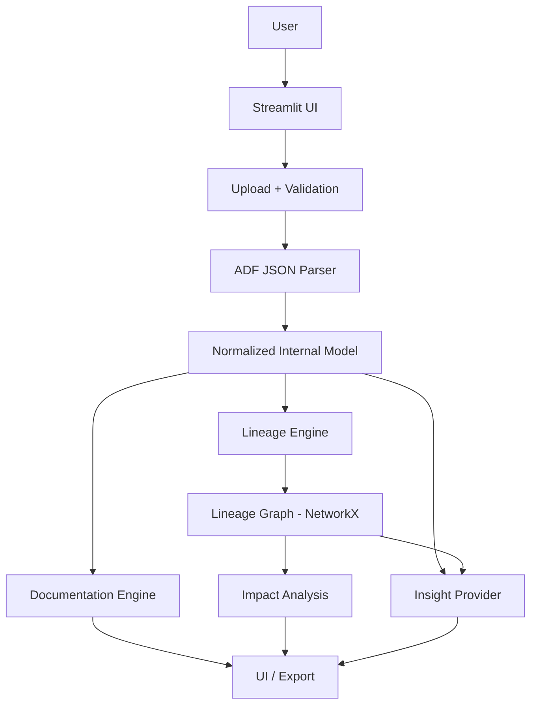

# PROJECT_PLAN.md

**Project:** Data Pipeline Intelligence — Automated Azure Data Factory Column-Level Lineage, Documentation & AI Insights

**Status:** **THE ENTIRE FEATURE CATALOGUE (F001–F024) IS COMPLETE.** The 8-page
Streamlit UI covers upload → dashboard → pipeline / data-flow explorers →
column search (per-flow *and* stitched across every uploaded artifact) → lineage
narrative + impact score + interactive graph → **Inventory** (sources / sinks /
transformations / datasets) → documentation (Markdown + HTML export) → AI
Insights (deterministic only; LLM support removed, see session 13). Remaining work is the section 16
Release Checklist (coverage on core packages, Docker image build verification,
security review of the upload path, 5 MiB performance check).

**Last updated:** 2026-09-22 (session 20)

**Verification (session 12):** `ruff check` clean · `ruff format --check` clean ·
`mypy` clean (47 files) · `pytest` 175 passed (incl. 7 Streamlit `AppTest` smoke
tests) · coverage 91% · Inventory aggregates every source / sink / transformation
and ties datasets to their reader/writer artifacts across pipelines + data flows.

> This file is the authoritative source of truth for implementation progress.
> Read it before every coding session. Update it after every meaningful change.

---

## 1. Product Vision

Enterprise data teams run large numbers of Azure Data Factory (ADF) pipelines and
Mapping Data Flows. The transformation logic is spread across deeply nested JSON
definitions that are hard to read, hard to audit, and effectively undocumented.
When someone asks *"where does `customer_id` come from, what happens to it, and
what breaks if I change it?"* the answer today requires an engineer to manually
trace JSON by hand.

**Data Pipeline Intelligence** ingests exported ADF JSON (no Azure connection),
reconstructs the pipeline and transformation model, and produces:

1. Deterministic **column-level lineage** (source → transformations → sink)
2. Automated **pipeline documentation**
3. Automated **Mapping Data Flow documentation**
4. Plain-language **transformation explanations**
5. **Interactive lineage visualization**
6. **Column impact analysis** (what depends on this column)
7. **AI-assisted insights** as an enhancement layer over deterministic facts
8. **Search & exploration** across columns and transformations
9. **Exportable documentation** (Markdown / HTML)

The deterministic lineage engine is the foundation. AI never invents lineage.

## 2. Goals

- Parse ADF **Pipeline JSON** and **Mapping Data Flow JSON** offline, from manual uploads.
- Normalize wildly varying ADF JSON into a stable internal model.
- Produce deterministic, reproducible column-level lineage.
- Generate readable documentation and visualizations without reading raw JSON.
- Answer "origin / journey / impact" questions for any column.
- Provide an AI insight layer that is optional and pluggable.
- Be genuinely production-ready: typed, tested, modular, secure, containerized, CI-ready.

## 3. Non-Goals

- **No** connection to Azure Data Factory (no API, no SDK, no auth, no subscription access).
- **No** Azure credential handling of any kind.
- **No** PostgreSQL / external database / Power BI / cloud data store.
- **No** persistence of uploaded files by default (in-memory processing).
- **No** execution of pipelines or data flows.
- **No** guarantee of support for every ADF activity, connector, or expression function.
- **No** sending of raw uploaded JSON to any external AI provider.
- Not a general SQL/Spark lineage tool — scope is ADF-exported artifacts.

## 4. Architecture

```
User
  │
  ▼
Streamlit Web UI  ──────────────────────────────────────────────┐
  │  (upload, dashboard, explorers, search, export)             │
  ▼                                                             │
Upload / Validation           app/parsers/json_loader.py        │
  │  size limit, type check, safe JSON decode, kind detection   │
  ▼                                                             │
ADF JSON Parser               app/parsers/*                     │
  │  pipeline_parser, dataflow_parser, expression_parser        │
  ▼                                                             │
Normalized Internal Model     app/models/*  (Pydantic)          │
  │  Pipeline, Activity, DataFlow, Transformation, Column, ...   │
  ├───────────────────────────────┬─────────────────────────────┘
  ▼                               ▼
Lineage Engine                 Documentation Engine
app/lineage/*                   app/documentation/*
  │                               │
  ▼                               ▼
Lineage Graph (NetworkX)       Markdown / HTML docs
  │
  ▼
Impact Analysis   app/lineage/impact.py
  │
  ▼
AI Insight Engine  app/insights/*  (InsightProvider abstraction)
  │
  ▼
UI / Export
```



### Layering rules

- Raw `dict` access to ADF JSON is confined to `app/parsers/`. Everything else
  works against `app/models/`.
- `app/ui/` imports services only, never parsers/lineage internals directly.
- `app/insights/` receives sanitized metadata objects, never raw JSON.
- `app/core/` has no dependencies on other app packages.

## 5. Technology Stack

| Technology | Purpose | Why |
| --- | --- | --- |
| Python 3.11+ | Primary language | Ecosystem for graph + data + Streamlit |
| Streamlit | Web UI | Fastest path to a professional internal tool UI; no frontend build |
| Pydantic v2 | Normalized models + validation | Strong typing, validation, serialization for AI sanitization |
| pydantic-settings | Configuration | Env-var / `.env` driven config, no hard-coded values |
| NetworkX | Lineage graph | Mature directed-graph algorithms (traversal, ancestors/descendants, cycles) |
| PyVis / Graphviz | Lineage visualization | Interactive + static rendering options (added in F015) |
| pytest + pytest-cov | Testing | Standard, fixture-friendly |
| ruff (+ ruff format) | Lint + format | Single fast tool for lint and formatting |
| mypy | Type checking | Static verification of the typed model layer |
| Docker | Containerization | Reproducible runtime |
| GitHub Actions | CI | Lint + format check + type check + tests on synthetic fixtures |

Deferred until their feature: `pyvis`, `graphviz`, `jinja2` (documentation
templates), `markdown` (HTML export). An LLM SDK was briefly added behind
`LLMInsightProvider` and removed in session 13 — insights are deterministic only.

## 6. Feature Catalogue

| ID | Feature | Status |
| --- | --- | --- |
| F001 | File Upload (UI) | [x] |
| F002 | JSON Validation & safe loading | [x] |
| F003 | Pipeline Parsing → normalized model | [x] |
| F004 | Mapping Data Flow Parsing → normalized model | [x] (DFS script parsed; column-dependency resolution is F021/F009) |
| F005 | Source discovery | [x] (Inventory page) |
| F006 | Sink discovery | [x] (Inventory page) |
| F007 | Transformation discovery | [x] (Inventory page) |
| F008 | Pipeline column lineage + cross-artifact stitching | [x] (Copy translator; dataset-identity stitch) |
| F009 | Column lineage engine | [x] (data flow; pipeline Copy lineage + stitch via F008) |
| F010 | Upstream lineage traversal | [x] (`app/lineage/traversal.py`; any graph) |
| F011 | Downstream lineage traversal | [x] (`app/lineage/traversal.py`; any graph) |
| F012 | Impact analysis + scoring | [x] (any `ColumnLineageGraph` — data flow / pipeline / combined) |
| F013 | Pipeline documentation generation | [x] (Markdown + HTML) |
| F014 | Data flow documentation generation | [x] (Markdown + HTML, incl. column lineage) |
| F015 | Lineage visualization | [x] (Graphviz DOT; PyVis via `viz` extra) |
| F016 | Column search | [x] (search box + picker in Column Lineage page; cross-artifact search TODO) |
| F017 | AI insights (Deterministic only; LLM support removed) | [x] |
| F018 | Documentation export (Markdown / HTML) | [x] |
| F019 | Error handling & user-facing warnings | [-] (core framework done) |
| F020 | Security (size limits, type checks, no-persist, sanitization) | [-] (upload path done) |
| F021 | Expression parser subsystem | [x] (data-flow dialect; pipeline dialect: functions + params only) |
| F022 | Dashboard (aggregate stats) | [x] |
| F023 | Pipeline Explorer UI | [x] |
| F024 | Data Flow Explorer + Column Lineage / Impact UI | [x] |
| F025 | Configuration management | [x] |
| F026 | Structured logging | [x] |
| F027 | Docker support | removed (session 18) - see below, distribution is now a wheel |
| F028 | CI pipeline | [x] |
| F029 | Analysis session / caching layer | [-] (session container done, caching TBD) |

## 7. Technical Tasks

### F025 Configuration management
- [x] T025.1 `AppSettings` via pydantic-settings, env prefix `ADFPI_`
- [x] T025.2 `.env.example`
- [x] T025.3 Upload size limit setting

### F026 Structured logging
- [x] T026.1 `configure_logging()` + `get_logger()`
- [x] T026.2 Never log uploaded JSON content (enforced by convention + review)

### F019 Error handling
- [x] T019.1 Exception hierarchy in `app/core/exceptions.py`
- [x] T019.2 `ParseContext` warning collector (non-fatal issues)
- [ ] T019.3 UI surfaces warnings per artifact without crashing (partially wired)
- [ ] T019.4 Circular dependency detection surfaced as warning

### F002 JSON Validation & safe loading
- [x] T002.1 Size-limit enforcement on raw bytes
- [x] T002.2 UTF-8 decode with explicit error handling
- [x] T002.3 `json.loads` with `InvalidJsonError` wrapping
- [x] T002.4 Reject non-object top-level
- [x] T002.5 Artifact kind detection (pipeline / mapping data flow / unknown)
- [x] T002.6 Tests

### F003 Pipeline Parsing
- [x] T003.1 `Pipeline`, `Activity`, `ActivityDependency`, `PipelineParameter`, `PipelineVariable` models
- [x] T003.2 Handle plain `{name, properties}` form
- [x] T003.3 Handle ARM resource form (`type: Microsoft.DataFactory/factories/pipelines`, `[concat(...)]` name)
- [x] T003.4 Parse activities, dependsOn, inputs/outputs dataset references
- [x] T003.5 Parse parameters & variables
- [x] T003.6 Execution order (topological sort) + cycle reporting
- [x] T003.7 Identify ExecuteDataFlow activity references
- [x] T003.8 Non-fatal handling of unknown activity types (kept, flagged)
- [x] T003.9 Tests

### F022 Dashboard
- [x] T022.1 `AnalysisSession` aggregate counts
- [x] T022.2 Dashboard page renders metrics
- [x] T022.3 Empty-state messaging

### F023 Pipeline Explorer
- [x] T023.1 Pipeline selector
- [x] T023.2 Overview (params, variables, annotations, description)
- [x] T023.3 Activity table + execution order
- [x] T023.4 Dependency list
- [x] T023.5 Data flow references

### F004 Mapping Data Flow Parsing (complete)
- [x] T004.1 `DataFlow` skeleton model + detection
- [x] T004.2 Parse sources / sinks / transformations list (+ dataset refs, source schema,
  sink input stream)
- [x] T004.3 Parse `scriptLines` DSL (Data Flow Script / DFS) — `app/parsers/dfs_script.py`:
  statement splitter, top-level tokenizer, `[inputs] operator(args) ~> output[@(branches)]`
  parser, recognized-operator set, unknown-operator flagging
- [x] T004.4 Column mapping per transformation (structural): `source` schema,
  `derive` assignments, `select` retained/renamed/derived via `mapColumn`,
  `aggregate` `groupBy` + aggregations. Raw expression text captured;
  which upstream columns feed each expression is F021/F009.
- [x] T004.5 Tests — `tests/unit/test_dfs_script.py` (12), `tests/unit/test_dataflow_parser.py` (6)

### F021 Expression parser (complete — data-flow dialect; pipeline dialect light)
- [x] T021.1 Tokenizer — `app/parsers/expression_parser.py` `_lex`: regex lexer
  (strings w/ escapes, `{braced idents}`, numbers w/ type suffix, `$params`,
  `#lambda` vars, operators incl. `@` stream-qualifier); reports lex gaps
- [x] T021.2 Function-call / identifier extraction (IDENT immediately before `(`)
- [x] T021.3 Referenced-column resolution (idents that are not functions,
  keywords, member-access `.x`, params or lambda vars; `stream@col` →
  `referenced_columns` + `qualified_columns`; `byName('col')`/`byNames([...])`
  literal treated as the column)
- [x] T021.4 Safe fallback: unbalanced parens/brackets or unterminated string →
  `confidence="none"` + note "Unable to determine automatically" + no columns;
  higher-order/lambda or unrecognized chars → `confidence="partial"` + note,
  columns still returned best-effort
- [x] T021.5 Tests — `tests/unit/test_expression_parser.py` (23):
  concat/upper/toString/iif/isNull/substring/sum/avg + braced idents, params,
  stream-qualified, byName, keywords, unbalanced, unterminated string,
  higher-order, unknown function, pipeline dialect
- [x] T021.6 Wired into `dfs_script.extract_columns` — `DataFlowColumnDef` now
  carries `referenced_columns` + `analysis_confidence` (retained cols map to
  themselves; derived/renamed/aggregate resolved via the parser)

### F009 Column lineage engine (complete — Mapping Data Flow scope)
- [x] T009.1 Lineage value types (`app/models/lineage.py`: `NodeKind`,
  `StreamKind`, `RelationshipType` + `.label`, `LineageNode`, `LineageEdge` +
  `passthrough`, `ColumnJourney` + `ColumnJourneyStep` + `.narrative()`)
- [x] T009.2 `ColumnLineageGraph` over NetworkX `DiGraph` (`app/lineage/graph.py`):
  column nodes `stream::column`, downstream-directed edges, per-relationship
  specificity so a stronger edge is never downgraded, `find` (bare / `.` / `@` /
  `::` qualified), `upstream`/`downstream`, `paths`, `has_cycle`, `to_dict`
- [x] T009.3 Direct mapping / passthrough (`select` retained → DIRECT; `derive`
  carry-through, `filter`/`join`/`union`/`sort`/unknown passthrough → PASSTHROUGH;
  `sink` → DIRECT)
- [x] T009.4 Rename detection (`select mapColumn(new = old)`, old an identifier)
- [x] T009.5 Derived-column dependency detection (via
  `DataFlowColumnDef.referenced_columns` from F021)
- [x] T009.6 Join / lookup dependency detection (first arg of `join(...)` →
  expression parser → `stream@col` keys → `JOIN_KEY` / `LOOKUP` edges; bare-name
  fallback)
- [x] T009.7 Aggregation (`group_by` keys → DIRECT; aggregate targets → AGGREGATE;
  non-key input columns dropped)
- [x] T009.8 Filter (participating columns → FILTER edges + `filter_expression` /
  `filter_columns` on the stream node)
- [x] T009.9 Union (like-named columns from every input → UNION edges)
- [x] T009.9b Conditional `split` (branch streams + condition columns →
  CONDITIONAL_SPLIT; `SplitName@branch` consumer refs normalised in
  `dfs_script._split_streams`)
- [x] T009.10 Upstream traversal + `explain()` narrative (`app/lineage/traversal.py`:
  `ancestors`, `origins`, `explain` → `ColumnJourney`)
- [x] T009.11 Downstream traversal (`descendants`, `sink_columns_reached`)
- [x] T009.12 Tests — `test_column_lineage.py` (11), `test_lineage_traversal.py` (6),
  `tests/integration/test_lineage_flow.py` (2)
- [x] T009.13 Service integration — `AnalysisService.data_flow_lineage()` (cached
  on `AnalysisSession.lineage_cache` by content hash) + `explain_column()`

### F012 Column impact analysis + scoring (complete — data-flow scope)
- [x] T012.1 `ImpactLevel` + `ImpactReport` model (`app/models/impact.py`) with
  `is_terminal`, `downstream_column_count`, `summary()`
- [x] T012.2 `analyze_impact(graph, node_id)` (`app/lineage/impact.py`) —
  direct vs indirect downstream, sink columns, transformations classified into
  joins / filters / splits / aggregations / other, computed
  (DERIVED/AGGREGATE/RENAME) columns affected, longest downstream path
- [x] T012.3 Deterministic weighted score — documented `_WEIGHTS` table
  (per-unit weight + contribution cap) + `HIGH_THRESHOLD` 60 / `MEDIUM_THRESHOLD`
  25; `factors` lists every contribution and the final `raw → clamped → LEVEL`
- [x] T012.4 Override rules — no downstream → LOW/0; sink reached via join or
  split → HIGH; ≥3 sink columns → HIGH; ≥1 sink column → floor MEDIUM
- [x] T012.5 Service integration — `AnalysisService.impact(lineage, query)`
- [x] T012.6 Tests — `tests/unit/test_impact.py` (10) + service test

### F015 Lineage visualization (complete)
- [x] T015.1 `build_dot(graph, *, focus, direction, max_nodes)` → Graphviz DOT
  string, `app/visualization/lineage.py` (no new dependency; `st.graphviz_chart`
  renders it with pan/zoom)
- [x] T015.2 Per-stream `cluster_*` subgraphs coloured by `StreamKind`
  (source/transformation/sink); nodes labelled by column name
- [x] T015.3 Edges coloured by `RelationshipType` (`RELATIONSHIP_COLORS`);
  passthrough dashed; short expression label on derived/rename/aggregate edges;
  relationship label as tooltip
- [x] T015.4 Focus mode — `focus_node_set()` restricts to a column's
  ancestors ∪ descendants; focus node / upstream / downstream colour-coded;
  `direction` ∈ both | upstream | downstream; `max_nodes` cap with a caption note
- [x] T015.5 Optional interactive `to_pyvis_html()` behind the `viz` extra
  (lazy import; clear `RuntimeError` if missing; DOT is the always-available path)
- [x] T015.6 `AnalysisService.lineage_dot(lineage, *, focus, direction)` —
  resolves a bare/qualified column name to a node id
- [x] T015.7 Tests — `tests/unit/test_visualization.py` (10, pyvis one skips
  without the extra) + service test

### F016 Column search + F024 Data Flow / Column Lineage UI (complete)
- [x] T016.1 `AnalysisService.list_columns(lineage)` / `search_columns(lineage, q)`
  (thin wrappers over `ColumnLineageGraph.find` / `iter_nodes`)
- [x] T024.1 `AnalysisService.summarize_data_flow(df)` → `DataFlowSummary` +
  `DataFlowTransformationRow` (UI-ready sources / sinks / transformations)
- [x] T024.2 Streamlit **Data Flow Explorer** page — pick a data flow; source
  table (dataset + schema), sink table (dataset + feeding stream), transformation
  table, per-transformation column-mapping expander (target ← from, kind,
  confidence, expression) + raw args, raw DFS script, parser warnings
- [x] T024.3 Streamlit **Column Lineage & Impact** page — pick a data flow;
  search box **or** column picker (F016); per match: impact level badge +
  score + downstream count + `summary()`, origins / sinks / affected
  transformations (joins / filters / splits), scoring `factors` expander,
  `explain_column` narrative, `st.graphviz_chart(lineage_dot(focus, direction))`,
  plus a full-graph expander; `direction` toggle both|downstream|upstream
- [x] T024.4 Dashboard: "Columns discovered" metric (distinct lineage nodes over
  all data flows; uses the session lineage cache)
- [x] T024.5 Streamlit smoke test — `tests/integration/test_ui_smoke.py` (3)
  via `streamlit.testing.v1.AppTest`

### F013 Pipeline documentation + F014 Data Flow documentation (complete — Markdown)
- [x] T013.1 `app/documentation/generator.py` — `_md_table` / `_joined` / `_cell`
  helpers, deterministic, no template dependency
- [x] T013.2 `pipeline_markdown(pipeline)` — title, overview (folder / concurrency
  / annotations), parameters & variables tables, execution flow (ordered
  activities + dependency table + cycle warning), activities table (type /
  depends-on / inputs / outputs / data-flow ref), data sources, data targets,
  referenced data flows
- [x] T014.1 `data_flow_markdown(df, lineage=None)` — sources / sinks tables,
  per-transformation section (inputs, group-by, raw DFS args, column-mapping
  table: target / kind / from / confidence / expression); with a lineage:
  `## Column Lineage` summary table (sink column → source column(s) →
  transformations) + `### Detailed paths` narrative per sink column + warnings
- [x] T013.3 Secret-safe — built from the normalized model only; test asserts no
  `Password` / `connectionString` / `redacted` in output
- [x] T013.4 `AnalysisService.document_pipeline` / `document_data_flow`
  (`include_lineage` flag, session-cached lineage)
- [x] T024.6 Streamlit **Documentation** page — pick artifact, "include column
  lineage" toggle, rendered / source view, `st.download_button` for `.md`
- [x] T013.5 Tests — `tests/unit/test_documentation.py` (9) + UI smoke case

### F018 Documentation export (complete)
- [x] T018.1 `app/documentation/export.py` `render_html(markdown, *, title)` +
  `markdown_to_html_fragment()` — purpose-built, **dependency-free** converter
  for the Markdown dialect `generator.py` emits (h1–6, fenced code, pipe tables
  w/ escaped `\|`, `- ` lists, `> ` blockquote, `**b**` / `_i_`). Every text run
  is HTML-escaped **before** any tag is added → safe against a malicious column
  name / expression from an uploaded file (verified: `` /
  `<script>` in a table cell are inert).
- [x] T018.2 Standalone `<!doctype html>` document, embedded CSS, escaped
  `<title>`, `color-scheme: light dark`.
- [x] T018.3 `AnalysisService.export_html(markdown, *, title)`.
- [x] T018.4 Documentation page — "Format" radio (Markdown / HTML); HTML shows
  the source + a `.html` `st.download_button`.
- [x] T018.5 Dropped the unused `docs` optional-dependency group from
  `pyproject.toml`.
- [x] T018.6 Tests — `tests/unit/test_export.py` (6) + UI smoke case. Total **141**.

### F017 AI insight providers (complete)
- [x] T017.1 `app/insights/sanitize.py` — `pipeline_request(summary)` /
  `data_flow_request(df, lineage=None)` / `column_request(journey, impact)` build
  `InsightRequest`. Structural facts only: names, counts, operators, relationship
  histograms, transformation expressions (logic, not data) — never raw JSON,
  connection details or column *values*.
- [x] T017.2 `DeterministicInsightProvider` (default, offline) — templated
  summary / observations / risks / recommendations per subject kind; reuses the
  lineage narrative, impact score and factors. No randomness, no network.
- [x] T017.3 `LLMInsightProvider` — optional; lazy `anthropic` import from the
  `llm` extra; system prompt forbids inventing lineage/facts and references to
  the JSON; sends only `request.facts`; `parse_result()` reads a JSON reply
  leniently (strips ``` fences, plain-text fallback); `RuntimeError` when the SDK
  or config is absent.
- [x] T017.4 `SafeInsightProvider(primary, fallback)` — any primary error →
  deterministic result + an "(AI provider unavailable)" observation.
  `get_provider(settings)` returns deterministic unless `settings.llm_ready()`.
- [x] T017.5 `AnalysisService`: `insight_provider_name`,
  `insights_for_pipeline / _data_flow / _column`.
- [x] T017.6 Streamlit **AI Insights** page — authoritative-engine disclaimer +
  active provider + "only structural metadata is used" note; per-artifact and
  per-column insight.
- [x] T017.7 Tests — `tests/unit/test_insights.py` (17) + UI smoke case. Total **156**.
- [x] T017.8 `mypy` override for `anthropic.*`.

### F008 Pipeline column lineage + cross-artifact stitching (complete)
- [x] T008.1 `app/parsers/translator.py` `parse_copy_mappings(type_props)` —
  `TabularTranslator.mappings[]` + legacy `columnMappings` string / dict forms;
  `Activity.column_mappings: tuple[(src, sink), ...]` populated for Copy activities
- [x] T008.2 `app/lineage/pipeline_lineage.py` `build_pipeline_lineage(pipeline)`
  — `dataset::column` nodes, one Copy edge per mapping (DIRECT / RENAME),
  `activity` + `transformation_type="Copy"`; warnings for Copy activities without
  an explicit translator or without in/out datasets
- [x] T008.3 `app/lineage/stitch.py` — `data_flow_bindings(df)` +
  `build_combined_lineage(lineages, extra_bindings)`: `_copy_into` merges every
  graph, then a `writer::col -> reader::col` edge (`transformation_type="dataset"`)
  is added for each column shared by a writer and reader of the same dataset;
  cycle across artifacts is reported, not fatal
- [x] T008.4 `DataFlowLineage` gains `kind` ("data_flow" | "pipeline" |
  "combined") + `bindings`; `AnalysisService.pipeline_lineage(pipeline)` /
  `combined_lineage(session)`
- [x] T008.5 UI — Column Lineage & Impact page **Scope** toggle
  (this data flow | all artifacts, stitched); Pipeline Explorer gains a
  Copy-activity column-lineage graph expander
- [x] T008.6 Tests — `test_translator.py` (6), `test_pipeline_lineage.py` (5),
  `integration/test_lineage_flow.py` cross-artifact trace, UI smoke case.
  Fixture `pipeline_copy_translator.json`. Total **168**.

### F005 Source discovery + F006 Sink discovery + F007 Transformation discovery (complete)
- [x] T005.1 `app/services/inventory.py` `build_inventory(pipelines, data_flows)`
  → `Inventory` (frozen dataclasses); pure, no session dependency
- [x] T005.2 `SourceEntry` — every data-flow source + every pipeline Copy input
  dataset (owning artifact, dataset, column count)
- [x] T006.1 `SinkEntry` — every data-flow sink + every pipeline Copy output
- [x] T007.1 `TransformationEntry` — every data-flow transformation (operator,
  column count, recognized) + every pipeline activity (type, recognized)
- [x] T005.3 `DatasetEntry` — dataset name → read-by / written-by artifacts +
  column count (`_DatasetAccumulator`); ties sources & sinks together
- [x] T005.4 `AnalysisService.inventory(session)`
- [x] T005.5 Streamlit **Inventory** page (6th tab position) — Datasets / Sources
  / Sinks / Transformations tabs
- [x] T005.6 Tests — `tests/unit/test_inventory.py` (6) + service test + UI smoke.
  Total **175**.
- [x] T005.7 Linked-service names / dataset formats are *not* inventoried (those
  live in Dataset / LinkedService JSON, classified "unknown"); noted in the
  module docstring and README compatibility matrix.

*(Feature catalogue complete. Remaining work is in section 16, Release Checklist.)*

## 8. Implementation Order

1. **Foundation** (config, logging, exceptions, project scaffold, CI, Docker) — ✅ done
2. **Vertical slice 1**: Upload → Validate → Parse Pipeline → Summary UI — ✅ done
3. **F004** Mapping Data Flow parsing (sources/sinks/transformations/scriptLines) — ✅ done
4. **F021** Expression parser — ✅ done
5. **F009** Column lineage engine (direct → rename → derived → join → aggregate → filter → union → split) — ✅ done (data-flow scope)
6. **F010/F011** Upstream / downstream traversal — ✅ done (data-flow scope)
7. **F012** Impact analysis + scoring — ✅ done (data-flow scope)
8. **F015** Lineage visualization — ✅ done (Graphviz DOT + optional PyVis)
9. **F024/F016** Data Flow Explorer + Column Lineage / Impact UI + column search — ✅ done
10. **F013/F014** Documentation engine — ✅ done (Markdown)
11. **F018** Export (Markdown + HTML download) — ✅ done
12. **F017** AI insight providers (Deterministic only; LLM support removed session 13) — ✅ done
13. **F008** Pipeline / Copy-activity column lineage + cross-artifact stitching — ✅ done
14. **F005–F007** Source / sink / transformation discovery (Inventory) — ✅ done
15. **Release Checklist** (section 16) — ◀ next

## 9. Testing Strategy

- **Unit**: JSON loader, kind detection, pipeline parser (each ADF shape), models,
  analysis service, later expression parser & lineage rules (one test per rule).
- **Integration**: bytes-in → `ParsedArtifact`/`AnalysisSession` out; multi-file sessions.
- **UI**: keep UI logic-free; test the services it calls. Optional `streamlit` smoke
  test via `streamlit.testing` added with F015+.
- **End-to-end**: fixture pipeline + data flow → lineage query for a known column →
  assert the documented path (added with F009).
- **Fixtures**: synthetic only, committed under `tests/fixtures/`. No production JSON.
- Coverage target: ≥ 85% on `app/parsers`, `app/lineage`, `app/models`.

## 10. Security Requirements

- Enforce configurable upload size limit on raw bytes **before** parsing (`ADFPI_MAX_UPLOAD_BYTES`, default 5 MiB).
- Accept only `.json` uploads; validate content is a JSON object.
- Process in memory; **never persist** uploaded files; no temp files for parsing.
- Never log uploaded JSON content or values; log only counts, names, and error types.
- `json.loads` only (no `eval`, no `pickle`, no YAML `load`, no code execution).
- Expression parser is analysis-only; it never evaluates expressions.
- AI providers receive a **sanitized** metadata model; raw JSON is never sent externally.
- No credentials, connection strings, linked-service secrets, or tokens are ever
  read, displayed, exported, or forwarded. Parser drops known secret-bearing fields.
- Uploaded content is treated as untrusted data, isolated from application code.
- No outbound network calls, ever — LLM insight support was removed in session 13;
  the deterministic provider is offline-only.

## 11. Performance Requirements

- Parse + normalize a 5 MiB pipeline JSON in < 2 s on a developer laptop.
- Parse once, normalize once, build lineage graph once per uploaded set; cache on
  the `AnalysisSession` keyed by content hash.
- Lineage traversal / impact for a single column: < 200 ms on graphs up to ~50k edges.
- Streamlit reruns must reuse cached analysis (via `st.session_state` / `st.cache_*`).

## 12. AI Architecture

- **Deterministic and authoritative**: JSON parsing, normalization, column mapping,
  lineage graph construction, upstream/downstream traversal, impact scoring,
  documentation structure, compatibility matrix.
- **Impact scoring formula** (F012, `app/lineage/impact.py`): raw score =
  Σ min(weight·count, cap) over {sink columns ×12/60, join/lookup ×10/30,
  conditional split ×8/24, aggregation ×8/24, filter ×6/24, other transformation
  ×4/20, computed downstream column ×3/30, direct fan-out ×2/10, longest
  downstream path ×3/15, directly-drives-a-gate ×10/10}, clamped to 0–100.
  Level: no downstream → LOW/0; sink via join or split → HIGH; ≥3 sinks or
  raw ≥ 60 → HIGH; ≥1 sink or raw ≥ 25 → MEDIUM; else LOW. `ImpactReport.factors`
  always shows the arithmetic.
- **AI-allowed (enhancement only)**: natural-language summaries of already-computed
  facts, readability rewrites of transformation explanations, qualitative
  complexity / risk / maintainability observations, improvement suggestions.
- **AI forbidden**: determining or altering lineage, inventing columns/edges,
  receiving raw uploaded JSON, being the source of any fact shown as authoritative.
- Abstraction: `InsightProvider` interface.
  - `DeterministicInsightProvider` — templated NL from the model; the only provider.
  - An `LLMInsightProvider` existed briefly (session 10) and was removed in session 13:
    it added an external dependency and network path with no compensating benefit at
    this stage. May be revisited later behind the same `InsightProvider` interface.

## 13. Future Enhancements

- Cross-pipeline / cross-data-flow lineage stitching by dataset identity.
- Diff mode: compare two exports, highlight lineage changes.
- Persistent project workspace (opt-in, encrypted at rest).
- Additional ADF activity coverage (Web, Databricks, Stored Proc, Lookup chains).
- Data quality / PII column tagging.
- REST API surface (FastAPI) reusing the service layer.
- Graph export to OpenLineage / DataHub formats.

## 14. Decision Log

**DEC-001** — Internal graph library
*Decision:* Use NetworkX `DiGraph` as the internal lineage graph.
*Reason:* Mature directed-graph traversal (`ancestors`, `descendants`,
`simple_paths`, cycle detection), pure-Python, no native deps, easy to serialize
for visualization backends.
*Date:* 2026-09-08

**DEC-002** — UI framework
*Decision:* Streamlit, single `app/ui/app.py` with sidebar navigation for now
(migrate to native `pages/` when page count grows).
*Reason:* Fastest route to a professional internal tool without a frontend build;
keeps all real logic in `app/services` so the UI stays thin and testable.
*Date:* 2026-09-08

**DEC-003** — Models with Pydantic v2 (not plain dataclasses)
*Decision:* Normalized model layer uses Pydantic v2 `BaseModel`.
*Reason:* Built-in validation, clear error messages, and `model_dump()` gives a
clean sanitized structure to feed the AI layer without bespoke serialization.
*Date:* 2026-09-08

**DEC-004** — Raw JSON access confined to `app/parsers/`
*Decision:* No module outside `app/parsers/` may index into raw ADF dicts.
*Reason:* ADF JSON varies by activity type and version; isolating that variance
in one layer keeps the rest of the app stable and testable.
*Date:* 2026-09-08

**DEC-005** — No file persistence
*Decision:* Uploads are processed from in-memory bytes; nothing is written to disk.
*Reason:* Uploaded ADF definitions are confidential enterprise assets.
*Date:* 2026-09-08

**DEC-006** — Package name `app`
*Decision:* Top-level package is `app` (per spec structure), distribution name
`data-pipeline-intelligence`.
*Reason:* Matches the requested project structure; keeps imports short.
*Date:* 2026-09-08

**DEC-007** — Data Flow Script (DFS) is the authoritative transformation source
*Decision:* The Mapping Data Flow parser derives sources, sinks and
transformations from `typeProperties.scriptLines` (the DFS), using
`typeProperties.transformations` only as a name cross-check.
*Reason:* Exported data flows put the real logic (column mappings, join keys,
group-bys, expressions) in the DFS; the `transformations` array is usually just
names/UI hints.
*Date:* 2026-09-08

**DEC-008** — DFS parsed by a hand-written tokenizer, not a grammar/PEG library
*Decision:* `app/parsers/dfs_script.py` is a small paren/quote-aware scanner.
*Reason:* The DFS surface we need (statement split, input streams, operator,
argument text, `mapColumn`/`groupBy`/assignments) is shallow and stable; a
dependency-free scanner keeps parsing deterministic and easy to extend per
operator. Deep expression analysis is a separate subsystem (F021).
*Date:* 2026-09-08

**DEC-010** — Lineage graph is column-nodes-only, edges point downstream
*Decision:* `ColumnLineageGraph` nodes are `"<stream>::<column>"`; an edge
``A → B`` means *B depends on A*. Stream-level info (operator, filter/join/split
condition, group-by) lives in `graph.stream_meta`, not as nodes.
*Reason:* `networkx.ancestors` = upstream/origin and `descendants` =
downstream/impact fall out for free; column-granular nodes are what search,
impact analysis and the "explain" narrative need. Edges carry a specificity rank
so a passthrough edge never overwrites a JOIN_KEY / DERIVED edge between the same
two columns.
*Date:* 2026-09-08

**DEC-011** — `select` output schema = its `mapColumn` list (no implicit passthrough)
*Decision:* A `select` transformation's output columns are exactly the ones
listed in `mapColumn(...)`. ADF's implicit "pass through unmapped columns"
behaviour is not modeled.
*Reason:* Exported data flows almost always list every column in `mapColumn`;
modeling the implicit rule would require resolving rule/pattern matching we
cannot see. Documented as a known limitation.
*Date:* 2026-09-08

**DEC-009** — Expression parser is a lexer + classifier, not an AST evaluator
*Decision:* F021 lexes an expression and classifies tokens (function vs column
vs param vs literal); it does not build/evaluate a syntax tree.
*Reason:* Lineage only needs *which columns are referenced*, not operator
precedence or values. A lexer is deterministic, tiny, safe (no eval) and easy to
extend. Ambiguous/unsupported input is reported via `confidence` ("high" /
"partial" / "none") and `notes` rather than guessed — "Do not guess" (§12).
*Date:* 2026-09-08

**DEC-012** — Error analyzer patterns are data (JSON), not code; unrecognized-error
capture is opt-in and out-of-scope of DEC-005
*Decision:* `app/insights/error_patterns.json` holds the F025 regex ->
error_type -> severity table plus per-type summary/next-steps text, loaded once
at import. `AppSettings.error_misses_path` (env `ADFPI_ERROR_MISSES_PATH`,
default `None`) is the **one** setting in the app that can enable writing
anything to disk: when set, a user can explicitly click "Flag this error" on an
`unknown_error` result to append it (redacted by
`app/insights/error_feedback.py`) to that file for later review.
*Reason:* (a) Adding a pattern shouldn't need a Python change/redeploy - a data
file does. (b) DEC-005 ("no persistence") is scoped to *uploaded ADF JSON*,
which is a confidential enterprise asset; pasted error text is a different,
lower-stakes input a user is actively trying to share for help. Making capture
opt-in (off by default, explicit per-click, redacted) extends the same
"user data isn't silently retained" spirit to this one exception rather than
breaking it.
*Date:* 2026-09-22

## 15. Known Limitations

- Pipeline column lineage covers **Copy activities with an explicit
  `TabularTranslator`** only. Copies without a translator, and column effects of
  Lookup / Stored-proc / Web / Script activities, are not derived.
- Cross-artifact stitching (F008) matches by **dataset name equality** across
  uploaded artifacts (a data-flow source/sink `dataset` ref = a pipeline Copy
  in/out dataset). Datasets referenced only by linked service, or the same
  logical table under different dataset names, are not linked. Stream-name
  collisions across data flows are treated as one node. A dataset both produced
  and consumed across artifacts creates a graph cycle (reported; longest-path
  impact metrics are then skipped).
- `select` output = its `mapColumn` list; ADF implicit passthrough of unmapped
  columns is not modeled (DEC-011).
- Lineage through `window`, `pivot`, `unpivot`, `flatten` and unknown operators
  is a passthrough approximation (columns those add/reshape are missed); a
  warning is emitted. `sink(... mapColumn(...))` remaps are not parsed.
- Join output assumes column names are unique across both sides; ADF's collision
  disambiguation is not modeled.
- Impact scoring (F012) weights and thresholds are a first calibration against
  synthetic fixtures — they may need tuning against real pipelines. The score
  treats every sink column as equally important (no notion of "critical"
  outputs). It works on any `ColumnLineageGraph` (data flow, pipeline or
  combined).
- Expression parser covers the **data-flow** dialect fully. The **pipeline**
  dialect only extracts function names and `pipeline().parameters.*` /
  `parameters('x')` / `variables('x')` references — this is intentional, not
  a pending gap: nothing in the app currently calls the pipeline dialect (see
  session 20), and pipeline-level ADF expressions don't reference dataset
  columns in the first place (data-flow expressions, which do, are already
  fully covered). The related, real gap — Copy activities without an explicit
  `TabularTranslator` (e.g. a custom SQL `source.query`) have no column
  lineage — is the first bullet above, expanded on in session 20; it would
  need a SQL column-list extractor, not an expression-parser change.
- Expression parser is lexical: higher-order functions with iterator vars
  (`reduce`, `mapIndex`, …) and unrecognized characters yield
  `confidence="partial"`; `case()` branch conditions are treated as plain
  argument columns (not split by branch).
- DFS coverage is structural for `source`, `derive`, `select`/`foldDown`
  (`mapColumn`), `aggregate` (`groupBy` + aggregations), `join`/`lookup`/`filter`/
  `union` (condition/argument expression decomposed into JOIN_KEY/LOOKUP/
  FILTER/UNION edges) and `window` (`over`/`asc`/`desc`/`windowColumns`
  decomposed into WINDOW edges; session 13). `pivot` decomposes `groupBy` (DIRECT)
  and approximates aggregate output names from a literal `pivotBy()` value list
  (AGGREGATE; session 13) - genuinely data-dependent otherwise. Remaining
  operators (`unpivot`, `alterRow`, `parse`, `surrogateKey`, …) are recognized
  and kept but their arguments are not yet decomposed. Unknown operators are
  flagged, never fatal.
- `split` branch streams are recorded on the statement (`output_branches`) but
  downstream references to a branch name are not yet linked in `stream_edges()`.
- No cross-artifact stitching: a pipeline's `ExecuteDataFlow` reference and the
  uploaded data flow of that name are not yet joined into one graph.
- Execution order uses `dependsOn` only. Control-flow constructs (`ForEach`,
  `Until`, `If`/`IfCondition`, `Switch`) have their inner activities recursively
  expanded into `Pipeline.activities` (tagged `parent_activity`/
  `container_branch`; session 13), so nested Copy/ExecuteDataFlow activities are
  visible to lineage/documentation/inventory - but `execution_order()` still
  treats them as a single flat DAG, not "runs once per loop iteration".
- ARM-template parameter expressions in names are only partially unwrapped
  (`[concat(parameters('factoryName'), '/Name')]` → `Name`); arbitrary ARM
  expressions are left as-is with a warning.
- Data Flow Explorer UI (F024) not built yet — data-flow results are currently
  visible only via the service layer / dashboard counts.
- No AI insights, visualization, search, documentation, or export yet.

## 16. Release Checklist

- [x] All catalogued features (F001–F024) implemented
- [-] Compatibility matrix in README reflects actual behavior (updated through F008;
  Inventory row added — re-review before release)
- [x] `ruff check` clean
- [x] `ruff format --check` clean
- [x] `mypy` clean (UI layer excluded per DEC-002)
- [x] `pytest` green (175 tests, incl. 7 Streamlit `AppTest` smoke tests)
- [x] Coverage ≥ 85% on core packages (91% overall, UI excluded; parsers/lineage/insights/documentation/visualization/services all ≥ 85%)
- [-] Docker image builds and `streamlit run app/ui/app.py` works in-container (Dockerfile written; app boot verified locally via `/_stcore/health` → ok; container build not yet run in this environment)
- [x] CI workflow runs lint + format + type + tests with no secrets
- [x] No secrets, credentials, or real pipeline JSON committed
- [ ] README screenshots / walkthrough updated
- [ ] Security review of upload + sanitization path
- [ ] Performance check against a 5 MiB synthetic pipeline

---

## Session Log

### Session 1 (2026-09-08) — Foundation + Vertical Slice 1
- Full project scaffold, `pyproject.toml`, `.gitignore`, `.env.example`, Dockerfile,
  `docker-compose.yml`, CI workflow, README, `docs/ARCHITECTURE.md`.
- `app/core`: `config.py`, `logging.py`, `exceptions.py`.
- `app/models`: `common.py`, `activity.py`, `pipeline.py`, `artifact.py`;
  `transformation.py`, `column.py`, `lineage.py` placeholders.
- `app/parsers`: `json_loader.py` (F002), `pipeline_parser.py` (F003), `base.py`.
- `app/services/analysis_service.py`; `app/ui/app.py` (Dashboard, Upload,
  Pipeline Explorer). 39 tests.

### Session 2 (2026-09-08) — F004 Mapping Data Flow parsing
- New `app/parsers/dfs_script.py`: deterministic Data Flow Script tokenizer
  (statement split, `[inputs] operator(args) ~> output[@(branches)]`, top-level
  comma/assignment splitters, `mapColumn`/`groupBy`/`output` extraction).
- Rewrote `app/models/dataflow.py`: `DataFlowScriptStatement`,
  `DataFlowColumnDef`, enriched `DataFlowSource/Sink/Transformation`,
  `DataFlow.stream_edges()` / `stream_names` / `unrecognized_operators`.
- Rewrote `app/parsers/dataflow_parser.py` to drive off the DFS (DEC-007/008).
- Fixtures: `dataflow_customer_full.json`, `dataflow_aggregate_union.json`,
  `dataflow_unknown_op.json`.
- Tests: `test_dfs_script.py` (12), `test_dataflow_parser.py` (6). Total **56**.
- Verified end-to-end: derive/select-rename/join/filter/union/aggregate all
  produce correct transformations, column defs and stream edges; unknown
  operator flagged, non-fatal.
- ruff + ruff format + mypy (29 files) clean.

### Session 3 (2026-09-08) — F021 Expression parser
- New `app/models/expression.py`: `ExpressionDialect`, `ExpressionAnalysis`
  (`referenced_columns`, `qualified_columns`, `functions`, `parameters`,
  `confidence`, `notes`, `.summary`).
- New `app/parsers/expression_parser.py`: regex lexer + token classifier,
  `ExpressionParser` (data-flow + light pipeline dialect), `analyze_expression()`.
- `DataFlowColumnDef` gained `referenced_columns` + `analysis_confidence`;
  `dfs_script.extract_columns` now runs the expression parser for
  derived/renamed/aggregate columns (retained → self).
- Tests: `test_expression_parser.py` (23); extended `test_dataflow_parser.py`.
  Total **79**.
- Verified: `customer_key ← customer_id`, `full_name ← first_name,last_name`,
  `cust_key ← customer_key`, `total_amount ← amount`, all `confidence="high"`;
  unbalanced/unterminated → "Unable to determine automatically".
- DEC-009 recorded. ruff + ruff format + mypy (31 files) clean.

### Session 4 (2026-09-08) — F009/F010/F011 Column lineage engine (Mapping Data Flow)
- `app/models/lineage.py`: added `StreamKind`, `RelationshipType.label`,
  `LineageNode.stream/column`, `LineageEdge.passthrough`, `ColumnJourney` +
  `ColumnJourneyStep` + `.narrative()`.
- New `app/lineage/graph.py` — `ColumnLineageGraph` (NetworkX `DiGraph` wrapper,
  `find`, `upstream`/`downstream`, `paths`, `has_cycle`, `to_dict`, edge
  specificity ranking).
- New `app/lineage/column_lineage.py` — `_Builder` walks streams in topological
  order and emits typed edges per operator (`source`, `select`, `derive`,
  `filter`, `join`/`lookup`, `aggregate`, `union`, `split`, passthrough
  fallback + warning); `build_data_flow_lineage()` / `DataFlowLineage`.
- New `app/lineage/traversal.py` — `ancestors`/`descendants`/`origins`/
  `sink_columns_reached`/`explain()`.
- `dfs_script._split_streams` normalises `SplitName@branch` consumer refs.
- `AnalysisService.data_flow_lineage()` (cached on `AnalysisSession.lineage_cache`)
  + `explain_column()`. New `AnalysisSession.get_data_flow_artifact()`.
- Fixture `dataflow_split.json`. Tests: `test_column_lineage.py` (11),
  `test_lineage_traversal.py` (6), `integration/test_lineage_flow.py` (2).
  Total **101**.
- DEC-010, DEC-011 recorded. ruff + ruff format + mypy (34 files) clean.

### Session 5 (2026-09-08) — F012 Column impact analysis + scoring
- New `app/models/impact.py` — `ImpactLevel`, `ImpactReport` (direct/indirect/all
  downstream, sink columns, joins/filters/splits/aggregations/other affected,
  computed columns affected, `score`, `level`, `factors`, `summary()`).
- New `app/lineage/impact.py` — `analyze_impact(graph, node_id)`; documented
  weight table + thresholds; override rules; `factors` shows the arithmetic.
- `AnalysisService.impact(lineage, query)`.
- Tests: `test_impact.py` (10) + `test_analysis_service` case. Total **112**.
- §12 updated with the scoring formula. ruff + ruff format + mypy (36 files) clean.

### Session 6 (2026-09-08) — F015 Lineage visualization
- New `app/visualization/lineage.py` — `build_dot()` (Graphviz DOT, no new
  dependency), `focus_node_set()`, `RELATIONSHIP_COLORS`, `to_pyvis_html()`
  (optional `viz` extra, lazy import). Per-stream clusters coloured by
  `StreamKind`; edges coloured by `RelationshipType`, passthrough dashed,
  expression labels on derived/rename/aggregate; focus mode with
  upstream/downstream colour-coding + `direction` + `max_nodes` cap.
- `AnalysisService.lineage_dot(lineage, *, focus, direction)` (resolves a
  column name to a node id).
- Tests: `test_visualization.py` (10; pyvis test skips without the extra) +
  service test. Total **123**.
- ruff + ruff format + mypy (37 files) clean.

### Session 7 (2026-09-08) — F024 Data Flow Explorer + Column Lineage UI + F016 search
- `AnalysisService`: `summarize_data_flow()` → `DataFlowSummary` /
  `DataFlowTransformationRow`; `list_columns()` / `search_columns()`.
- `app/ui/app.py`: dispatch table; two new pages —
  **Data Flow Explorer** (source/sink/transformation tables, per-transformation
  column-mapping + raw args expanders, raw DFS script) and
  **Column Lineage & Impact** (search box + picker, impact badge/score/factors,
  origins/sinks/affected transformations, narrative, focused + full Graphviz
  charts, direction toggle). Dashboard gains a "Columns discovered" metric.
- Tests: `tests/integration/test_ui_smoke.py` (3, `streamlit.testing` AppTest).
  Total **126**. Live app verified serving.
- ruff + ruff format + mypy (37 files) clean.

### Session 8 (2026-09-08) — F013/F014 Documentation engine (Markdown)
- New `app/documentation/generator.py` — `pipeline_markdown()` /
  `data_flow_markdown(df, lineage=None)`; deterministic plain-string assembly
  (no template dep); built from normalized models only, so scrubbed secrets
  cannot leak.
- `AnalysisService.document_pipeline()` / `document_data_flow(..., include_lineage)`.
- `app/ui/app.py`: new **Documentation** page (artifact picker, lineage toggle,
  rendered/source view, `.md` download button).
- Tests: `tests/unit/test_documentation.py` (9) + a UI smoke case. Total **135**.
- ruff + ruff format + mypy (38 files) clean.

### Session 9 (2026-09-08) — F018 Documentation export (HTML)
- New `app/documentation/export.py` — `render_html(markdown, *, title)` +
  `markdown_to_html_fragment()`; a purpose-built, dependency-free converter for
  the generator's Markdown dialect. Every text run HTML-escaped before wrapping
  (XSS-safe against uploaded column names / expressions).
- `AnalysisService.export_html(markdown, *, title)`.
- Documentation page: "Format" radio (Markdown / HTML) + `.html` download.
- Removed the unused `docs` optional-dependency group.
- Tests: `tests/unit/test_export.py` (6) + UI smoke case. Total **141**.
- ruff + ruff format + mypy (39 files) clean.

### Session 10 (2026-09-08) — F017 AI insight providers
- New `app/insights/`: `sanitize.py` (`pipeline_request` / `data_flow_request` /
  `column_request` → `InsightRequest`, structural facts only), `deterministic.py`
  (`DeterministicInsightProvider`, offline templated prose per subject kind),
  `llm.py` (`LLMInsightProvider` + `parse_result`, lazy `anthropic`),
  `safe.py` (`SafeInsightProvider` fallback wrapper), `__init__.get_provider()`.
- `AnalysisService`: `insight_provider_name`, `insights_for_pipeline /
  _data_flow / _column`.
- New Streamlit **AI Insights** page (7th page).
- `mypy` override for `anthropic.*`.
- Tests: `tests/unit/test_insights.py` (17) + UI smoke case. Total **156**.
- ruff + ruff format + mypy (43 files) clean.

### Session 11 (2026-09-08) — F008 Pipeline column lineage + cross-artifact stitching
- New `app/parsers/translator.py` (`parse_copy_mappings`); `Activity.column_mappings`.
- New `app/lineage/pipeline_lineage.py` (`build_pipeline_lineage`) and
  `app/lineage/stitch.py` (`data_flow_bindings`, `build_combined_lineage`).
- `DataFlowLineage` gained `kind` + `bindings`.
- `AnalysisService.pipeline_lineage()` / `combined_lineage(session)`.
- UI: Column Lineage & Impact page **Scope** toggle (per-flow | stitched);
  Pipeline Explorer Copy-activity lineage expander.
- Fixture `pipeline_copy_translator.json`. Tests: `test_translator.py` (6),
  `test_pipeline_lineage.py` (5), integration cross-artifact trace, UI smoke.
  Total **168**.
- ruff + ruff format + mypy (46 files) clean.

### Session 12 (2026-09-08) — F005/F006/F007 Discovery (Inventory)
- New `app/services/inventory.py` — `build_inventory(pipelines, data_flows)` →
  `Inventory` (`SourceEntry` / `SinkEntry` / `TransformationEntry` /
  `DatasetEntry`); pure aggregation, no session dependency.
- `AnalysisService.inventory(session)`.
- New Streamlit **Inventory** page (8th) with Datasets / Sources / Sinks /
  Transformations tabs.
- Tests: `tests/unit/test_inventory.py` (6) + service test + UI smoke. Total **175**.
- **Feature catalogue F001–F024 is now complete.**
- ruff + ruff format + mypy (47 files) clean.

**Bugfix (session 12):** `streamlit run app/ui/app.py` failed with
`ModuleNotFoundError: No module named 'app.core'` when run without an editable
install (Streamlit puts the script's own dir on `sys.path`, not the repo root).
Earlier "boot checks" were false-positives — `/_stcore/health` returns `ok` from
the server even when the app script fails to import. Fixed by a `sys.path`
bootstrap at the top of `app/ui/app.py` (repo root = `Path(__file__).parents[2]`);
`E402` per-file-ignored for the imports that now follow it. Verified by executing
the script from an unrelated CWD.

**Enhancement (session 12):** the Upload page now lists *Loaded artifacts* with a
per-item **Remove**, per-failure **Dismiss**, and **Clear all**. New
`AnalysisSession.remove(content_sha256)` / `clear()` (also drop the cached
lineage). The `file_uploader` carries a `key` bumped on every removal so the
widget empties and does not re-ingest. Total **177** tests.

**Enhancement (session 12):** the Add page now has **Upload file(s)** / **Paste
JSON** tabs. Paste is a `clear_on_submit` form → `AnalysisService.analyze_upload`
via a shared `_ingest_one()` helper (same size limit, validation, secret scrub);
the name defaults to `pasted.json`. Total **179** tests.

**Real-export fix (session 12):** a user's Mapping Data Flow used `foldDown`
(the DFS token for the **Flatten** transformation, wrapping `unroll(...)`), which
was not in `RECOGNIZED_OPERATORS`. Added `foldDown` / `unroll`; `foldDown` now
routes through the `select` lineage rule (it uses `mapColumn(...)`), so Flatten
columns are decomposed instead of passthrough. `_op_select` falls back to
passthrough when a select/Flatten auto-maps with no explicit `mapColumn`. The
unrecognized-operator warning wording is calmer ("kept; treated as passthrough;
lineage approximate"). Fixture `dataflow_flatten.json`. Total **178** tests.

### Session 13 (2026-09-22) — Remove LLM/GPT4All AI integrations; deterministic only
- Removed the F025 error-analyzer's optional GPT4All (`gpt4all_provider.py` /
  `gpt4all_utils.py`) path: it required the `gpt4all` package, which broke on
  Intel macOS (`sysctl.proc_translated` shell-out) and was never reachable from
  the UI anyway (`analyze_error()` was never called with `use_ai=True`). Removed
  `AISuggestion` model, `ErrorAnalysis.ai_suggestions`, `use_ai` param on
  `analyze_error()` / `AnalysisService.analyze_error()`, `AIAnalysisError`, and
  the dead "AI Diagnosis" UI block.
- Removed F017's `LLMInsightProvider` (`app/insights/llm.py`) and
  `SafeInsightProvider` (`app/insights/safe.py`) fallback wrapper.
  `get_provider(settings)` now unconditionally returns
  `DeterministicInsightProvider()`. Removed `AppSettings.enable_llm_insights` /
  `llm_provider` / `llm_model` / `llm_api_key` / `llm_ready()`.
- Removed `gpt4all` (hard dependency) and the `llm` extra (`anthropic`) from
  `pyproject.toml`; dropped both from the mypy override list.
- Rationale: the app's core value (deterministic, offline lineage) doesn't need
  either AI path today, and both added dependency/attack surface without a
  working feature behind them. `InsightProvider` remains an abstraction, so an
  LLM provider can be reintroduced later without touching callers.
- Tests: removed `test_gpt4all_provider.py` (16) and the LLM-specific cases in
  `test_insights.py` / `test_config.py` / `TestAIIntegration` in
  `test_error_analyzer.py`. Full suite green, `mypy app` clean (0 errors, down
  from 4 pre-existing).

### Session 14 (2026-09-22) — Control-flow expansion + window/pivot decomposition
- **F027 Control-flow activity expansion:** `Activity` gained `parent_activity` /
  `container_branch` (`"loop"`, `"true"`/`"false"`, `"case:<value>"`, `"default"`)
  + `is_nested`. `app/parsers/pipeline_parser.py._parse_activities()` recursively
  walks `ForEach`/`Until` (`typeProperties.activities`), `IfCondition`/`If`
  (`ifTrueActivities`/`ifFalseActivities`) and `Switch` (`cases[].activities` +
  `defaultActivities`), flattening every nested activity into
  `Pipeline.activities` alongside the container itself (name collisions across
  scopes warn, don't fail — ADF requires pipeline-wide unique names in practice).
  This required **no changes** to `pipeline_lineage.py`, `inventory.py` or the
  documentation generator: they already iterate `pipeline.activities` generically,
  so nested Copy/ExecuteDataFlow activities became visible for free. Added a
  "Container" column to the pipeline Activities doc table. Fixture
  `pipeline_control_flow.json` (ForEach → If → Switch, 3 levels deep).
- **`window` decomposition:** parses `over(...)` (partition columns),
  `asc()`/`desc()` (sort columns) and `windowColumns(...)` (`target = expr`
  targets) from `raw_arguments`; existing columns passthrough, new targets get
  `RelationshipType.WINDOW` edges from both their expression's referenced
  columns and the partition/sort columns. `RelationshipType.WINDOW` already
  existed (graph/visualization/plain-language/impact-scoring all supported it)
  but was never emitted anywhere until now. Fixture `dataflow_window.json`.
- **`pivot` decomposition:** `groupBy()` columns → DIRECT (always knowable).
  Aggregate expressions (`<expr> as <alias>`) → AGGREGATE edges; when
  `pivotBy(col, [literal, values])` gives an explicit literal list, output
  columns are approximated as `<alias>_<value>` (flagged as approximate - ADF's
  `columnNaming` template may order/format differently) instead of the previous
  behaviour of blindly passing through *every* input column unchanged, which was
  actively wrong (pivot fundamentally restructures the schema). Without a
  literal value list, only the groupBy columns are represented, with a warning
  that the rest is data-dependent. `unpivot` was deliberately left as generic
  passthrough-approximation (its DFS syntax differs enough from `pivot` that
  guessing would risk being *confidently wrong*, worse than a flagged
  approximation). Fixture `dataflow_pivot.json`.
- Fixed stale compatibility-matrix claims in README/AGENTS/PROJECT_PLAN: several
  rows already said "Partial - not decomposed" for `join`/`lookup`/`filter`/
  `union`/`flatten`, which were in fact already fully decomposed (from earlier
  sessions) — the docs just hadn't been updated to match the code.
- Tests: `test_control_flow_activities_are_expanded`,
  `test_control_flow_copy_lineage_is_visible`,
  `test_pipeline_markdown_shows_nested_activity_container`,
  `test_window_partition_sort_and_expression_columns_are_linked`,
  `test_pivot_groupby_is_direct_and_values_approximated`. Full suite green,
  `mypy app` clean, `ruff check` clean.

**Next recommended task:** work the **section 16 Release Checklist**:
1. Verify the Docker image builds and `streamlit run app/ui/app.py` serves inside
   the container.
2. Security review of the upload → sanitization → insight-request path (size
   limit, `json.loads`-only, no disk writes, secret scrub, sanitized
   `InsightRequest`, HTML-escape in export).
3. Performance check: parse + lineage + combined graph on a ~5 MiB synthetic
   pipeline / data flow; confirm the < 2 s / < 200 ms targets in §11 and add a
   `scripts/` benchmark.
4. Final README compatibility-matrix + screenshots pass; tag a `0.1.0` release
   checklist review.

Remaining lineage-completeness gaps (lower priority, all correctly flagged
"Partial"/"Approx." in the compat matrix, not silently wrong): `unpivot`
argument decomposition (`parse`/`surrogateKey` done in session 19; `unpivot`
deliberately deferred - no documented DFS syntax, see session 19);
`execution_order()` doesn't model ForEach loop-iteration or If/Switch
branch-exclusivity semantics (a loop body and both If branches all appear as
one flat DAG). The "pipeline-dialect expression parser... no column notion"
item originally listed here was investigated and scoped out in session 20 -
it wasn't a real gap as framed; see that entry.

### Session 15 (2026-09-22) — F025 error analyzer: real-error hardening pass
- The regex classifier in `app/insights/error_analyzer.py` was tested only
  against hand-written synthetic strings. Collected ~35 verbatim real-world ADF
  error messages from Microsoft's official troubleshooting docs
  (`data-flow-troubleshoot-guide`, `connector-troubleshoot-guide` - the
  `DF-Executor-*` "Common error codes and messages" catalogue) and from real
  Copy activity / SQL Server sink failures reported on Microsoft Q&A / Stack
  Overflow (`ErrorCode=UserErrorInvalidColumnMappingColumnNotFound`, "Invalid
  column name", "Violation of PRIMARY KEY constraint", "Cannot insert the value
  NULL into column ... does not allow nulls", "String or binary data would be
  truncated", "Conversion failed when converting ...", "FOREIGN KEY
  constraint", etc.). Before this session **27 of 34** were misclassified as
  `unknown_error`; after, all 34 classify correctly.
- Added ~25 new `_ERROR_PATTERNS` regexes (column-mapping-not-found, SQL Server
  NULL/truncation/conversion wording, DF-Executor expression/column-not-found
  text, throttling/OOM/service-limit text, connection/auth failures) ordered
  specific-before-generic per the existing convention; added 4 new error types
  with checkpoints/summary/next-steps: `foreign_key_violation`,
  `throttling_error`, `resource_exhausted`, `limit_exceeded`.
- Fixed a real entity-extraction bug found while building the test corpus:
  `_ENTITY_PATTERNS`' column/dataset/stream regexes matched an *unquoted* word
  after "column"/"table"/"field", so messages like "column does not allow
  nulls" or "table with a smaller column length" extracted `does`/`with`/`in`/
  `is`/`has` as fake column names. Quotes are now required around the captured
  name (real ADF/SQL error text always quotes identifiers); the noisy reversed
  fallback pattern was removed. Added a `constraint` entity type for
  `PK_x`/`FK_x` constraint names.
- Tests: `tests/unit/test_error_analyzer.py` gained a parametrized
  `test_real_world_error_is_classified` over 24 of the real messages (sourced
  in a comment, citing Microsoft Learn + Q&A/Stack Overflow), asserting both
  the correct `error_type` and that no stopword leaked into
  `detected_entities`. Full suite green, `mypy app` / `ruff check` /
  `ruff format --check` all clean.

### Session 16 (2026-09-22) — Real column lineage in the UI + broader error coverage

**Part 1 - the UI never rendered real column lineage.** `analyze_error()` already
computed `ErrorAnalysis.suggested_lineage` (real `ColumnJourney` objects, matched
against the combined graph of uploaded artifacts) via `_generate_lineage_suggestions`
- the service layer was correct. The UI (`page_error_analyzer`) never displayed it;
it only drew a graph inline inside a checkpoint of `checkpoint_type == "column"`,
which `missing_column` (checkpoints are `stream`+`transformation`) - the single most
common error type - never produces. So the one case a user would most want "show me
this column's lineage" for silently never showed it. Replaced that dead-end code
with a dedicated **Column Lineage** section driven directly by
`analysis.suggested_lineage`: origin(s), sink columns reached, the plain-language
`journey.narrative()`, and a graph focused on `journey.node_id`, for every detected
column that has a real match - not a generic recommendation. Added
`test_error_analyzer_shows_real_column_lineage_for_a_loaded_data_flow` (Streamlit
AppTest) asserting the rendered page actually contains it, not just that the backend
computed it.

**Part 2 - broadened `error_patterns.json` from 60 to 108 patterns / 28 to 33 error
types,** covering categories the user asked for by name: SQL Server (login/deadlock/
timeout/syntax), PostgreSQL (`relation ... does not exist`, `violates not-null
constraint`, `duplicate key value violates unique constraint`, `password
authentication failed`, `permission denied for table`), Oracle (`ORA-00942`,
`ORA-01017`), MySQL (`doesn't exist`, `Access denied for user`), Parquet (all of
`connector-troubleshoot-parquet`'s error codes: invalid file, column-not-found,
type-conversion, schema/column-count mismatch, arithmetic overflow), self-hosted
Integration Runtime (`self-hosted-integration-runtime-troubleshoot-guide`:
registration failure, missing auth key, offline node, missing Java Runtime, JVM
creation failure), missing ADF components (broken dataset/linked-service/pipeline/
trigger references - distinct from `dataset_not_found`, which is about a *runtime*
datastore object missing, not a broken JSON reference), and Data Flow debug-session
errors (expired/terminated session, `Spark cluster not found`). Added 5 new
`error_type`s with their own tailored (non-generic) checkpoints/summary/next-steps:
`schema_mismatch`, `transient_db_error`, `debug_session_error`,
`integration_runtime_error`, `component_not_found` - each explicitly says the
problem is *not* a lineage/data issue (infra, a broken reference, or transient
concurrency), since routing those to "trace column lineage" would be actively
misleading.
- Verified against a 48-case real-world corpus (all 33 error types hit at least
  once) before writing it up as 29 new parametrized test cases in
  `test_error_analyzer.py`, plus a check that the 5 new infra-flavored types never
  fall through to the generic "trace complete lineage path" checkpoint.
- Full suite green (262 tests), `mypy app` / `ruff check` / `ruff format --check`
  all clean.

(Undocumented at the time: a `.docx` export feature was also added this same
session - `app/documentation/docx_export.py`, wired into `AnalysisService` and
the Documentation page's "Word (.docx)" format option - styled title page,
auto-updating TOC field, bordered/banded tables, code-styled expression/trace
blocks, page-numbered footer; optional `docx` extra, same lazy-import pattern
as pyvis. Backfilled here since it landed without a session write-up.)

### Session 17 (2026-09-22) — Real internal ADF error samples

Incorporated a batch of real error samples reported by the team (18 full
messages + 10 bare internal alerting-tool codes like `DFSchemaMismatch`,
`BusinessValidationError` with no message text). All 27/27 were `unknown_error`
before this session; all classify correctly now.

- Added ~30 new patterns across existing categories: `resource_exhausted`
  (`executor lost`, `executor ... exited unexpectedly`, `broadcast ...
  exceeded/threshold`), `path_access_denied` (`not authorized to perform this
  operation` without requiring literal "forbidden"/"403"; `permission denied
  (for|on) (table|relation|schema|database|object)` - broadened from
  table/relation/schema/database only), `sink_write_failed` (`path already
  exists and cannot be overwritten`), `null_constraint_violation` (`parameter
  ... cannot be null`, `parameter is empty`), `invalid_expression` (`does not
  exist in array`), `type_conversion_error` (`unable to convert`),
  `format_error` (`expected delimiter ... not found`, `is not in ... format`),
  `connection_failed` (`could not open connection to`, `database unavailable`),
  `schema_mismatch` (`contains \w+ and \w+ values` - mixed-type column
  inference), `join_mismatch` (`row multiplication` - cardinality/fan-out,
  distinct from a join that fails outright).
- New `business_validation_error` type: a custom data-quality/business-rule
  threshold breach (e.g. "Unexpected increase in LoanIQ outlier count.
  Expected <100 records but received 25,431") is fundamentally different from
  every other category here - the pipeline ran *correctly*; the source data is
  what's flagged. Its checkpoint says so explicitly ("review the source data
  ... this isn't a pipeline bug") rather than pointing at lineage tracing,
  same principle as the session 16 infra types.
- New `custom_codes` pattern group (lowest priority, checked last): bare
  internal alerting-tool codes matched on their own when no message text is
  present, e.g. `DFExecutorUserError` -> `resource_exhausted`,
  `ArrayIndexOutOfBounds` -> `invalid_expression`. A real message with more
  specific wording always wins first since this group sits at the end of
  `error_patterns.json`.
- `error_patterns.json`: 108 -> 137 patterns, 33 -> 34 error types. Tests:
  27 new parametrized cases in `test_error_analyzer.py` plus a check that
  `business_validation_error` gets its own checkpoint, not the generic
  lineage-trace fallback. Full suite green, `mypy app` / `ruff check` /
  `ruff format --check` all clean.

### Session 18 (2026-09-22) — Drop Docker for a wheel; Streamlit deprecation fix; security review

**Distribution: Docker -> wheel.** Removed `Dockerfile` and `docker-compose.yml`
(the latter was already broken - it referenced `ADFPI_ENABLE_LLM_INSIGHTS`,
removed in session 13). F027 in the catalogue is now "removed"; end-user
distribution is `python -m build --wheel` -> a single `.whl` a user downloads
and `pip install`s, no container runtime needed. Fixed a `project.license`
TOML-table deprecation (setuptools >=77 wants an SPDX string) surfaced while
verifying the build. **Verified for real**, not just "it builds": installed the
actual built wheel into a fresh, isolated venv (not the dev checkout - `import
app` from inside the source tree would silently shadow the installed copy) and
confirmed `app/insights/error_patterns.json` is present as package data,
`adf-intelligence` boots, and `GET /_stcore/health` returns `200`. README
"Docker" section replaced with "Building a wheel", including that exact
verification recipe so it doesn't bit-rot silently next time.

**Streamlit deprecation fix.** All 4 `st.graphviz_chart(..., use_container_width=True)`
calls (`page_pipeline_explorer`, `page_column_lineage` x2, `page_error_analyzer`)
-> `width="stretch"`; `use_container_width` is removed after 2025-12-31.
Confirmed via AppTest that the deprecation warning is gone and the pages still
render without exception.

**Security review of the upload path.** Systematically re-verified each
documented guarantee against the actual code (not just the docs):
- Only `json.loads` used anywhere in `app/` (grepped for
  `eval|exec|pickle|yaml|__import__|subprocess|os.system` - the only
  `subprocess` call is the `adf-intelligence` launcher shelling out to a fixed
  `streamlit run` command, unrelated to uploaded content).
- Logging: `ParseContext.warn()` (parse-time, goes to the real Python logger)
  only ever embeds structural metadata (names, counts) - confirmed by grepping
  every `ctx.warn(f"...")` call site. `_Builder.warn()` (lineage-time, embeds
  raw DFS expression text into warnings) only appends to an in-memory list,
  **never** reaches the logger - confirmed by reading its implementation.
  `app/core/logging.py` logs to stderr only, no file handler, matching the
  in-memory-only architecture.
- Secret scrubbing: `pipeline_parser.py` already called `scrub_secrets()` on
  `typeProperties`; `dataflow_parser.py` did **not**. In practice this wasn't
  exploitable today (`DataFlowParser` only ever extracts specific whitelisted
  fields - name, dataset reference, DFS script text - never the raw dict
  itself), but it was a real gap between the documented universal guarantee
  and the code, and a future field read could silently reintroduce a leak.
  Fixed: `dataflow_parser.py` now scrubs `typeProperties` too, with a test
  proving a `password`/`accountKey`-shaped key injected into a data flow
  source never survives parsing.
- **Real bug found and fixed:** a JSON file well **under** the 5 MiB upload
  limit can nest deeply enough (~150k levels, <1 MB) to blow Python's
  recursion limit inside `json.loads()`, raising an uncaught `RecursionError`
  - not the clean `InvalidJsonError` every other malformed-input path
  produces. `load_adf_json()` now catches `RecursionError` alongside
  `JSONDecodeError`. This was a genuine gap: the size limit alone doesn't
  bound nesting depth, so a tiny adversarial (or just very ugly,
  programmatically-generated) file could crash the analysis instead of
  failing cleanly.
- XSS-safety of the HTML export was already verified in session 16 with an
  actual `<script>`/`onerror` payload; re-confirmed still holds.

Full suite green, `mypy app` / `ruff check` / `ruff format --check` all clean.

### Session 19 (2026-09-22) — `parse` / `surrogateKey` lineage decomposition

Closed two of the three lineage gaps flagged in session 14/16 (`unpivot` stays
deliberately deferred - see below).

- **`parse`** (verified DFS syntax against `data-flow-parse.md`:
  `<target> = <source> ? (<field> as <type>, ...), format: '...', ...`):
  decomposes to exactly one new DERIVED struct-typed column from its source,
  alongside every existing column passing through unchanged (parse doesn't
  consume its source string column). The struct's declared *inner* fields
  aren't separate top-level columns at the DFS level - a later `select`/
  `derive` unpacking one via dot notation (`trade = json.trade`) already
  resolves correctly back to the parse-produced column through the existing
  expression parser (confirmed: `analyze_expression("json.trade")` already
  returns `referenced_columns=("json",)`), so no extra work was needed there.
- **`surrogateKey`/`keyGenerate`** (verified syntax:
  `<stream> keyGenerate(output(<col> as long), startAt: 1L) ~> Name`): adds
  one new column with **no** upstream dependency - it's a generated sequence,
  correctly its own lineage origin, not derived from any input. This fixes a
  real, not just cosmetic, gap: previously `keyGenerate` fell through to
  plain passthrough, which only carries columns that already exist in the
  input schema - the surrogate key column was **invisible in the lineage
  graph entirely**, not merely mis-attributed.
- **`unpivot` deliberately NOT attempted**: fetched Microsoft's own
  `data-flow-unpivot.md` directly and confirmed it contains no Data Flow
  Script syntax example at all (UI-configuration screenshots only). Guessing
  the script grammar risks being confidently wrong - worse than the existing,
  correctly-labeled "Partial" passthrough approximation - so it stays as is.
  Compatibility matrix row narrowed from `unpivot`/`parse`/`surrogateKey`/…
  down to just `unpivot`/….
- New fixtures `dataflow_parse.json`, `dataflow_surrogate_key.json`; 2 new
  tests in `test_column_lineage.py`, including one asserting the surrogate key
  column now actually appears in the sink schema (the "previously invisible"
  regression). Full suite green (297 tests), `mypy app` / `ruff check` /
  `ruff format --check` all clean.

**Next recommended task:** the remaining release-checklist item - a ~5 MiB
synthetic pipeline/data-flow performance benchmark (parse + lineage + combined
graph, confirm the <2s/<200ms targets in §11).

### Session 20 (2026-09-22) — Scoped out: pipeline-dialect "column notion"

Investigated the session 14/16 note ("pipeline-dialect expression parser only
extracts function names + parameter/variable refs, no column notion") before
building it, the same way `unpivot`'s DFS syntax was checked before being
attempted in session 19. Conclusion: **as originally framed, it isn't a real
gap worth closing**, for three concrete reasons found by reading the code
rather than assuming:

1. **`ExpressionDialect.PIPELINE` is dead code.** Grepped every call site of
   `analyze_expression()` in the app (seven, all inside
   `column_lineage.py`/`dfs_script.py`) - all seven pass the default
   (data-flow) dialect. Nothing anywhere ever constructs
   `ExpressionParser(ExpressionDialect.PIPELINE)` or calls
   `analyze_expression(..., dialect=ExpressionDialect.PIPELINE)`. The gap is
   in a path nothing currently calls.
2. **Pipeline-level ADF expressions don't reference columns.** `@concat(...)`,
   `pipeline().parameters.x`, `activity('X').output.y` deal in parameters,
   variables and activity-output fields - not row-level dataset columns. A
   "column notion" doesn't map onto anything ADF actually exposes at the
   pipeline expression level; data-flow expressions (which do reference
   columns) already have full support via the default dialect.
3. **The real underlying gap is already documented, and is different work.**
   §15 already states pipeline column lineage covers Copy activities with an
   explicit `TabularTranslator` only. A Copy activity that reads via a custom
   SQL `source.query` instead of a straight table copy has zero lineage today
   - confirmed by grepping the parsers: `query`/`sqlReaderQuery` is never read
   anywhere. Closing *that* gap means a narrow, explicitly best-effort SQL
   `SELECT col1, col2 FROM table` column-list extractor for Copy activity
   source queries - parsing an embedded SQL dialect, not the ADF `@`-expression
   language this parser already handles. Meaningfully different (and riskier:
   real SQL varies far more than ADF's expression grammar - aliases,
   `SELECT *`, joins, CTEs, quoting conventions) from the parser work already
   done, so it's called out here as a distinct, separately-scoped future
   feature rather than folded into "pipeline dialect column notion" - not
   attempted this session.

**Decision:** drop "pipeline-dialect column notion" from the active gap list.
If Copy-activity-without-translator lineage is wanted later, scope it as the
SQL `source.query` column extractor described above, not as an expression
parser enhancement.
